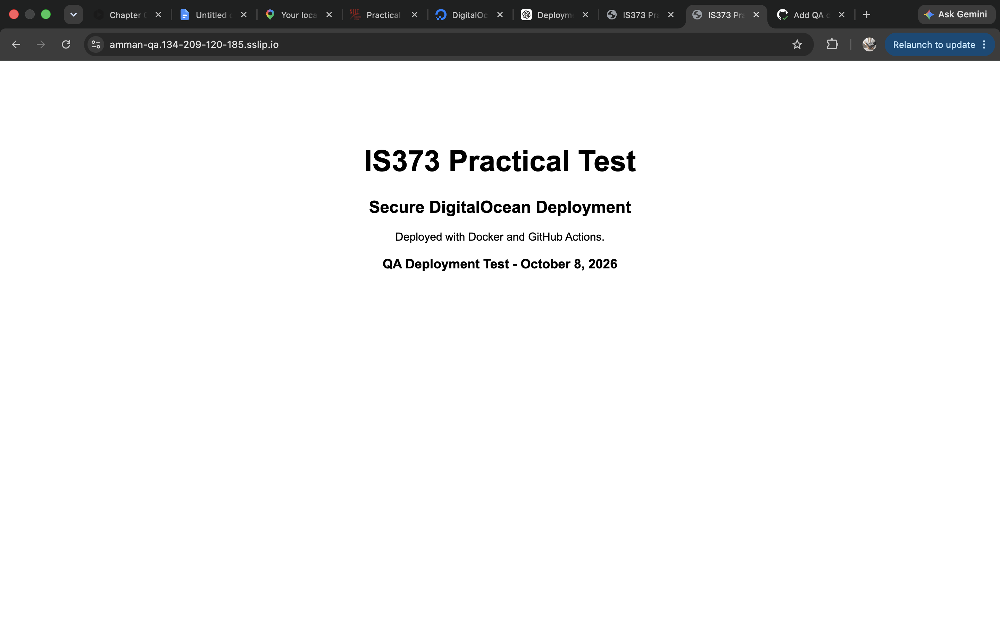
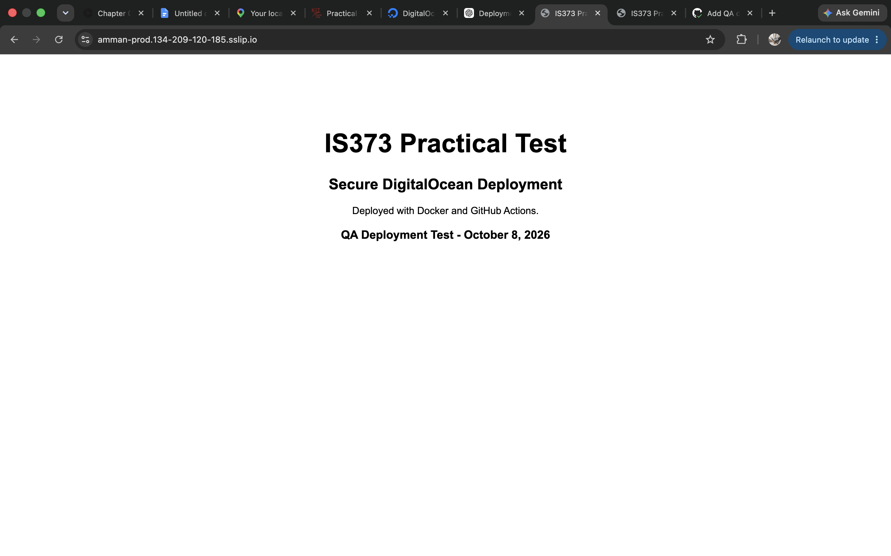
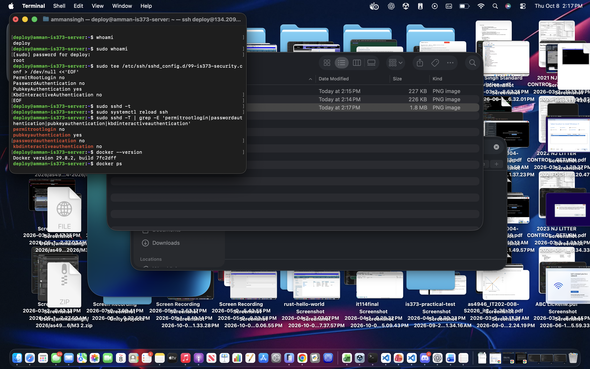
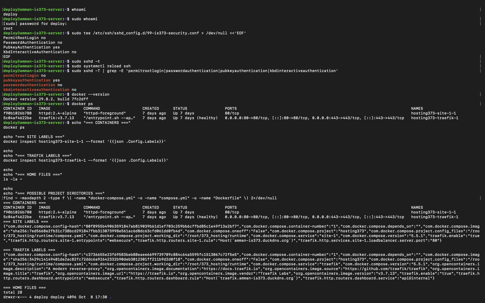

# IS373 Practical Test

Secure containerized website deployed to a DigitalOcean server using Docker and GitHub Actions.

## Deployment Sites

- QA: https://amman-qa.134-209-120-185.sslip.io
- Production: https://amman-prod.134-209-120-185.sslip.io

Both QA and production are served over HTTPS.

## CI/CD Process

Pushes to the `qa` branch automatically:

1. Validate the website files.
2. Build the Docker image.
3. Push the image to GitHub Container Registry.
4. Connect to the DigitalOcean server.
5. Automatically deploy the QA container.

After the QA version is tested, the `qa` branch is merged into `main`.

Pushes to `main` run the same validation, build, image push, and deployment process for production.

If validation or the Docker build fails, deployment stops and the website is not deployed.

## SSH Security

The DigitalOcean server is administered using the non-root `deploy` account.

SSH security settings:

- `PermitRootLogin no`
- `PasswordAuthentication no`
- `PubkeyAuthentication yes`
- `KbdInteractiveAuthentication no`

The `deploy` account authenticates using an SSH key and has sudo access. Root SSH login and password-based SSH login are disabled.

## Test Evidence

### Successful Workflow Runs

- QA workflow: https://github.com/Singh01113/is373-practical-test/actions/runs/37821792046
- Production workflow: https://github.com/Singh01113/is373-practical-test/actions/runs/37822007189

### Docker Image Registry

GitHub Container Registry:

`ghcr.io/singh01113/is373-practical-test`

Image tags:

- QA: `qa`
- Production: `production`

### Deployed Commit

`194b15f32f48c6b585ea756f8c1f6ca76714e713`

### Promotion Test

A visible change displaying:

`QA Deployment Test - October 8, 2026`

was first pushed to the `qa` branch and automatically deployed to the QA site.

After confirming the change worked in QA, the `qa` branch was merged into `main`. GitHub Actions then automatically deployed the same change to the production site.# IS373 Practical Test

Secure containerized website deployed to a DigitalOcean server using GitHub Actions.

## Sites

QA:
https://amman-qa.134-209-120-185.sslip.io

Production:
https://amman-prod.134-209-120-185.sslip.io

## CI/CD Process

Pushes to the `qa` branch validate the website, build a Docker image, push the image to GitHub Container Registry, and automatically deploy the QA container.

Pushes or merges to `main` perform the same process and automatically deploy production.

If validation or the Docker build fails, deployment stops.

## SSH Security

The DigitalOcean server uses a non-root `deploy` account.

SSH key authentication is enabled.

Root SSH login is disabled.

Password-based SSH login is disabled.

## Test Evidence

Screenshots and successful GitHub Actions workflow links will be added after testing QA and production.

### Screenshots

#### QA Deployment

#### Production Deployment

#### SSH Security Settings

#### Non-root SSH User

